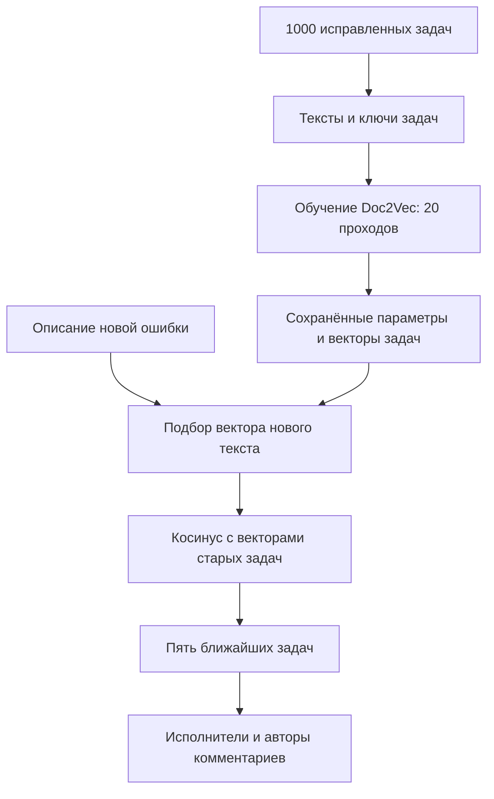
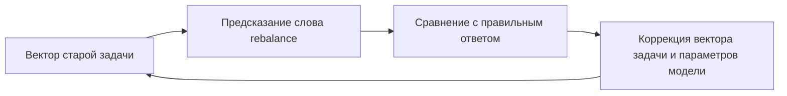
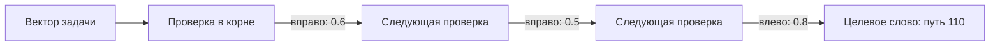
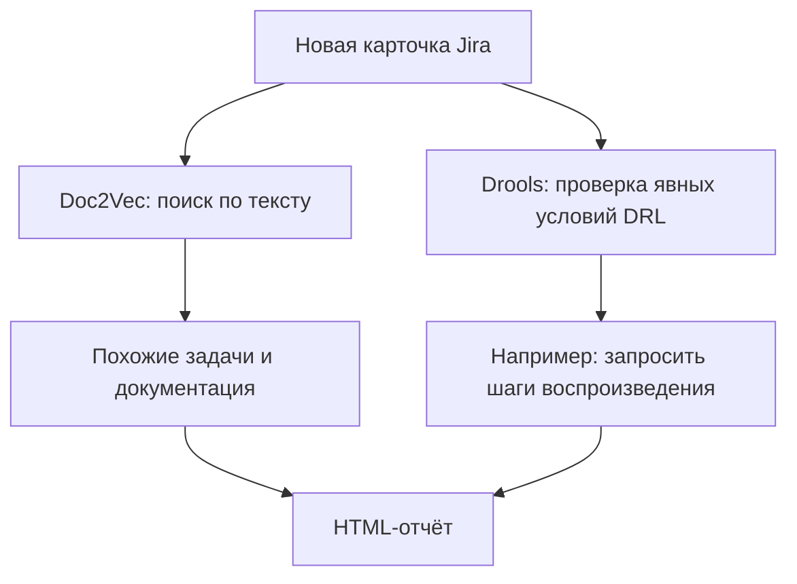

# Как iResolver получает рекомендации

Разберём один запрос: «После изменения подписки consumer не происходит rebalance». Это текст ошибки. Нужны старые задачи с похожей темой, подходящие страницы руководства и кандидаты в исполнители.

## Обучение и поиск — два отдельных этапа

Модель сначала учится на исправленных задачах. При обычном запуске сохранённая модель загружается: заново учить её не нужно. Новая ошибка не добавляется в обучающую выборку; для её текста вычисляется отдельный вектор.

Для документации используется самостоятельная модель: вместо задач обучающие документы — страницы PDF. Оценки двух моделей напрямую не сравниваются.

## Что именно обучается

Вектор задачи — 100 чисел. Сначала числа случайны. Одна координата не означает заранее «транзакции», другая — «сеть»: значения подбираются совместно.

Вариант PV-DBOW пытается по вектору документа предсказать слова из этого документа. Например, для старой задачи с текстом про `consumer`, `subscription`, `rebalance` получаются обучающие примеры «вектор задачи → consumer», «вектор задачи → subscription» и «вектор задачи → rebalance». Это упрощённая иллюстрация: перед обучением iResolver применяет стемминг и удаление стоп-слов.

Цель коррекции — увеличить вероятность реально встречающегося слова. Она рассчитывается по градиенту ошибки, а не по правилу «прибавить среднее всех слов». Много задач обучаются через общие параметры предсказания слов. Поэтому задачи с похожим словоупотреблением могут получить близкие векторы. Это ожидаемое свойство обучения, а не гарантия для каждой пары текстов.

Одновременно в данном запуске обучаются векторы слов методом Skip-Gram: по центральному слову предсказываются слова окружения. Например, в «consumer changed subscription» центральное `changed` связывается с `consumer` и `subscription`. В большем окне пары допускают промежутки между словами. Обычные биграммы описывают пары соседних слов; Skip-Gram использует пары в качестве обучающих примеров для получения векторов.

## Для чего используется дерево Хаффмана

Предсказывать одно слово из большого словаря дорого. При иерархическом softmax словарь организован как дерево: листья — слова, каждый внутренний узел — обучаемая проверка «влево или вправо».

Код слова задаёт правильный маршрут. Например, для кода `110` нужно пройти вправо, вправо, влево. Вектор задачи передаётся в проверки на этом пути. Они дают вероятности нужных переходов, например 0,6, 0,5 и 0,8. Вероятность целевого слова равна их произведению: 0,24. Обучение повышает вероятность правильного пути, изменяя параметры этих проверок и вектор задачи.

Показан только путь к одному слову; альтернативные ветви опущены. Каждая проверка вычисляет вероятность с учётом текущего входного вектора и своих обучаемых параметров. Топология дерева строится по частотам: частым словам достаются короткие пути. При обучении одного примера не требуется обработать все слова словаря. Код Хаффмана — адрес листа, а не вектор слова и не мера его смысла.

## Как анализируется новая ошибка

При выводе вектора новой ошибки обученные параметры предсказания сохраняются. Подбирается вектор нового текста, который позволяет лучше предсказывать слова его описания. Затем вектор сравнивается с векторами старых задач.

Обычно используется косинус: сумма произведений соответствующих координат делится на произведение длин векторов. Для `(1, 2)` и `(2, 4)` косинус равен 1: направления совпадают. Для `(1, 2)` и `(2, 1)` он равен 0,8. Одинаковая формула применяется в 100 измерениях.

В исходном iResolver показывается `abs(cosine * 100)`, поэтому знак отрицательного значения теряется. «70%» здесь не означает вероятность того, что исправление подойдёт. В сохранённом эксперименте подходящая по теме задача KAFKA-19899 найдена для KAFKA-21409 уже при 57,4%. Полезность результатов проверяется по содержанию.

## Где здесь Drools

Drools не обучается: разработчик пишет условие `when` и действие `then`. В нашем правиле при отсутствии слов-маркеров воспроизведения добавляется предложение запросить подробности. `AnalysisService` передаёт карточку в `DroolsRuleEngine`, а тот выполняет правила. `ResultWriter` сохраняет результаты двух независимых механизмов в общий отчёт.

Источники: [Doc2Vec](https://arxiv.org/abs/1405.4053), [Skip-Gram и иерархический softmax](https://arxiv.org/abs/1310.4546), [iResolver](https://github.com/kovaloid/iresolver/tree/2480ab354472e504a0825298023366b7f047eba2).
